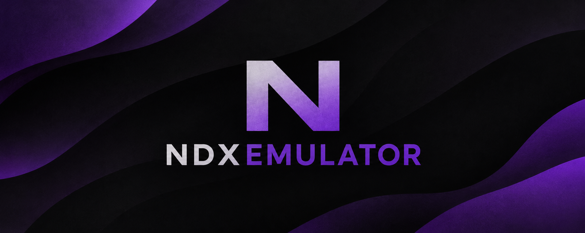

<p align="center">
  
</p>

<h1 align="center">NDXEMULATOR</h1>

<p align="center">
  Emulador de jogos retrô para Android, com biblioteca, saves automáticos e controle físico.
</p>

<p align="center">
  
  
  
</p>

---

## O que ele faz

- Biblioteca de jogos organizada por console, com capas e miniaturas dos seus saves.
- Lê ROMs dentro de arquivos `.zip`, `.7z` e pastas, sem precisar extrair.
- Save-state automático ao pausar, ao sair e a cada 60 segundos. Ao abrir o jogo de novo, ele continua de onde parou.
- Saves manuais com miniatura, lista de todos os saves e opção de excluir qualquer um deles.
- Configurações de vídeo por jogo: tamanho da imagem, shader, taxa de atualização, escala de renderização e resolução interna do N64.
- Velocidade de jogo em 1×, 2× e 4×.
- Controles na tela que somem sozinhos quando um gamepad é detectado e voltam ao tocar na tela.
- Posição e tamanho dos botões na tela podem ser editados.
- Backup dos saves para uma pasta escolhida por você, com backup automático ao voltar do emulador.

## Consoles e núcleos

| Console | Núcleo | Extensões de ROM |
| --- | --- | --- |
| NES | FCEUmm | `.nes` `.unf` `.unif` |
| Super Nintendo | Snes9x 2010 | `.sfc` `.smc` `.swc` `.fig` |
| Game Boy / Color | Gambatte | `.gb` `.gbc` |
| Game Boy Advance | mGBA | `.gba` |
| Mega Drive / Genesis | Genesis Plus GX | `.md` `.gen` `.smd` |
| PlayStation 1 | PCSX ReARMed (nativo), DuckStation (app externo) | `.cue` `.bin` `.chd` `.pbp` |
| Nintendo 64 | Mupen64Plus-Next (GLES3) | `.z64` `.n64` `.v64` |
| GameCube e Wii | Dolphin (app externo) | `.gcm` `.rvz` `.iso` `.wbfs` |

O Lemuroid (app externo) também é aceito como alternativa para os consoles acima, exceto GameCube e Wii.

### Android TV ARM 32 bits (armeabi-v7a)

O APK é universal: leva os cores leves (NES, SNES, GB, GBA, Mega Drive, PS1 e N64) para `armeabi-v7a` (ARM 32 bits, como a Philips Android TV 11) e para `arm64-v8a`. O script `scripts/fetch_cores.sh` confere o cabeçalho ELF de cada `.so` baixado (classe e arquitetura) e o workflow repete essa conferência dentro do APK final; um `.so` com a arquitetura errada derruba o build. No aparelho, o app também lê o cabeçalho do `.so` empacotado antes de dizer que um core está pronto ou incompatível.

Flycast (Dreamcast), melonDS (Nintendo DS), PPSSPP (PSP) e PCSX2 (PlayStation 2) são pesados demais para a TV ARM32: vão só na pasta `arm64-v8a` (celular) e o workflow derruba o build se algum aparecer em `armeabi-v7a`.

Você pode ativar ou desativar cada emulador em **Configurações → Emuladores e plugins**.

## Como usar

1. Em **Configurações → Pastas e armazenamento**, adicione a pasta onde estão seus jogos.
2. Escolha um console na tela inicial e abra a biblioteca dele.
3. Toque no jogo para ver as opções: Continuar, Novo Jogo, Reiniciar Save, Configurações do Jogo ou Excluir Jogo.

Para PlayStation 1, o PCSX ReARMed precisa da BIOS do console. Coloque os arquivos em `Android/data/com.nandox.arcade/files/system`. NES, SNES, Game Boy, GBA, Mega Drive e Nintendo 64 não precisam de BIOS.

## Saves e backup

Os saves ficam dentro da pasta do app, então atualizar o NDXEMULATOR não apaga nada. Desinstalar, porém, apaga essa pasta. Para se proteger, escolha um **Destino dos backups** fora do app em **Dados salvos** e ative o backup automático. Para recuperar os saves depois de reinstalar, use **Restaurar** na mesma tela.

## Controles

Funcionam controles Bluetooth e USB, como Xbox, PlayStation e controles genéricos. Os botões da tela aparecem sozinhos quando nenhum controle está conectado.

## Compilar

O projeto usa GitHub Actions. Cada push para `main` gera um APK de depuração que você baixa na aba **Actions**, no artefato `nandox-arcade-debug`.

Para compilar localmente:

```bash
bash scripts/fetch_cores.sh
./gradlew assembleDebug
```

## Créditos

Os núcleos libretro vêm do [buildbot oficial da Libretro](https://buildbot.libretro.com). A integração com o libretro usa a biblioteca [LibretroDroid](https://github.com/Swordfish90/LibretroDroid).


https://github.com/NandoXuu/NandoxArcade-Next-Advanced/actions/runs/43646258943/artifacts/14134066729
